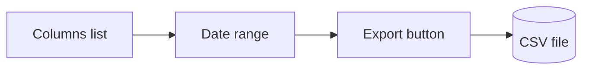

# Write Documents

## Overview

A document works when its reader gets what they need, finds it, understands it and can use it (ISO 24495-1, the plain-language standard).
Length is measured in ideas, not in words. Cut an idea the reader does not need, never a word a sentence needs.

**Applies to:** PR bodies, issue and review comments, READMEs, documentation, guides, research reports, handoffs, knowledge-base pages, decision requests.
**Not for:** chat replies.

**Priority between rule sources:** the repository's own rules (`CLAUDE.md`, `CONTRIBUTING.md`) come first, then the genre's skill (`write-french` for French, `write-guide` for guides, `capturer-connaissance` for knowledge-base pages), then this skill.
The order decides; it never yields to how specific a rule is.

**Priority inside this skill:** a rule that keeps the reader able to understand or act beats a rule that shortens the text.
The rules that shorten are `nothing-extra` and the "no idea twice" part of `one-idea`.
Example: a gloss stays even when it lengthens the sentence.

## 1. Frame, before writing

**`answer-first`** - Name the document's one question and its one reader.
Lead with the answer or the conclusion.
In a guide or a README, the answer is what the thing does and what the reader does first.
Give reasoning only where it changes the reader's decision.

| Avoid | Write |
|---|---|
| `# Cache product pages` then `## Background` with last month's latency graphs | `# Cache product pages for 60 s` then "Product pages now load from a 60 s cache. The catalog database saturates at peak traffic (measured on the March load test)." |

**`scope`** - A guide or a design document states what it covers and what it does not.

| Avoid | Write |
|---|---|
| A guide that starts at step 1 | "This guide covers the Export screen. It does not cover scheduled exports or the export file format." |

## 2. Content and form

**`self-contained`** - The document holds what the reader needs to understand it and act on it.
What to do goes in the document; how a mechanism works goes behind a link.
Test: reread the document ignoring every link; rewrite any sentence that stops making sense.
When the thing can fail, say what the reader sees and what they do, not how the failure is detected.
A pure reference page (a command cheat sheet, a service inventory) is exempt.

| Avoid (README of a backup tool) | Write |
|---|---|
| "The agent snapshots the volume, compresses it with zstd, uploads it in 64 MB parts and compares each part's ETag." | "Backups run every night. Each one is verified after upload. A failed backup makes the job exit 2. Run `backup retry` to start it again. How backups work: `docs/design/backups.md`." |
| "Exit 3: the agent compared the part's hash with the one stored in `state.json` and found a mismatch." | "Exit 3: an upload was corrupted. Run `backup retry` to upload it again." |

**`provenance`** - A number the document keeps, or a claim that supports a decision or a recommendation, carries its provenance as a half-sentence in place ("measured on one excerpt"). That half-sentence also says why the claim has that strength.
- Keep a source's strength, give the sample size, and claim nothing beyond the evidence. State the measurement, not a generalization drawn from it.
- Keep a caveat next to the number it qualifies, not in a "Limitations" section further down.
- A number that will age keeps what the reader needs in the text, such as its order of magnitude, with the date it was read and a link to its live source.
- A choice that departs from the project's default says why.
- Name the source of a claim, or cut the claim. This covers advice, caveats and contacts absent from your input.

| Avoid | Write |
|---|---|
| "Latency drops from 900 ms to 120 ms." | "On one load test of staging (500 requests), median latency dropped from 900 ms to 120 ms." |
| "The timeouts are short-lived. In one replay, they stopped after 2 s." | "In one replay, the timeouts stopped after 2 s." |
| "Ask the DBA if you are unsure." (no DBA in the input) | Cut it. |

**`nothing-extra`** - Cut what does not serve the document's question.
- No commentary on the research or the writing. A provenance half-sentence is not commentary.
- A document kept current (README, docs, knowledge-base page, skill) holds no history, rejected alternative, past incident or snapshot of the day, such as a rollout calendar. A dated document may.
- A PR body does not restate what the tool already shows: no commit list, no file-by-file list, no test-by-test list. An empty section becomes one line, such as "Nothing to run."
- No recap or checklist at the end that repeats the steps.
- Link text names what the reader will find behind the link. It never summarizes it.
- A guide or a README teaches only what the reader needs to use the thing: no lesson on the method behind it, and no origin or meaning of a name beyond the gloss `define-terms` asks for.

| Avoid | Write |
|---|---|
| "`tests/test_cache.py`: 3 new tests. `test_hit`: a second call returns the cached page..." | "Tests cover a cache hit, expiry after 60 s and a bypass for logged-in users. The suite passes (212 tests)." |
| `[Why we rejected Redis, and the Q3 rollout plan](docs/cache.md)` | `[Cache design](docs/cache.md)` |
| A guide to the A/B-test screen that opens with a section on why randomized trials work, and says the method dates from 1920s agriculture | A guide that opens with what the screen does and the first step |

**`decision-context`** - A document asking for a decision opens with one line giving the question and the recommendation.
Then it recalls the context the decision depends on: the incident, the goal, the stake, the history, the rule in force.
Then it gives the options.

| Avoid | Write |
|---|---|
| "@Sam I need a decision on the cache task." then the options, and the recommendation last | "@Sam: should we drop the cache task? I recommend dropping it, because the database upgrade removed the saturation it was meant to fix." |

**`examples`** - Follow an abstract rule or notion with a short concrete example.
A rule about writing or behavior gets an "avoid / write" pair, as in this skill.
An explanation shows one case worked end to end: key terms, then intuition, then the formal statement.

| Avoid | Write |
|---|---|
| "The p95 is the value below which 95% of requests fall." | The same sentence, then: "Out of 100 requests sorted by duration, the p95 is the 95th: here 420 ms." |

**`form-by-use`** - Choose the form by what the reader must do with the content.
- An argument read in order -> prose.
- Exact values to compare -> a table.
- Data, raw or aggregated, whose shape matters -> a chart.
- Steps -> a numbered list or a flowchart.
- Architecture -> a diagram.
- An interface -> a screenshot or a mock-up.

In a Markdown document, write a diagram as a ```` ```mermaid ```` block, which GitHub renders.
Give it an `accTitle:` and an `accDescr:` line, which screen readers read.
Put labels on the figure itself.
Never let color alone carry a meaning.
Cut a figure that distracts from the point.

| Avoid | Write |
|---|---|
| "The screen has a column list, then a date range, then an Export button." | The sentence, then the mock-up below. |

````markdown

````

## 3. Sentences and words

**`one-idea`** - One idea per sentence, one point per paragraph and per section, no idea twice.

| Avoid | Write |
|---|---|
| "The job retries three times, which covers the rate-limit window we saw, though we have not run it against production." | "The job retries three times. That covers the rate-limit window seen in one replay. It has not run against production yet." |

**`define-terms`** - Gloss every reference at its first use: a term, an acronym, a named person or framework, internal shorthand.
- Gloss it even when specialists know it, unless the document's named reader works with it every day. Judge by that reader, not by your own familiarity.
- The gloss is a clause, not a second claim.
- In a list of names, a name glossed elsewhere in the document stays bare. A name glossed nowhere leaves the list.
- Use one term per concept throughout the document.

| Avoid | Write |
|---|---|
| "Pick the settings you want to vary." in the opening, "factors" from then on | "Pick the factors - the settings you want to vary." in the opening, "factors" from then on |

## 4. Before delivering

**`obey-own-rules`** - A document that states rules obeys them, its examples and format included.

| Avoid | Write |
|---|---|
| A style guide that says "one idea per sentence" in a sentence holding three ideas | The rule stated in a sentence holding one idea |

**`dated-names`** - Name a document whose content no longer changes (research, test report, handoff, synthesis) `YYYY-MM-DD-<slug>.md`, unless a written instruction or a numbered sequence in the directory names it otherwise.

| Avoid | Write |
|---|---|
| `cache-load-test.md` | `2026-03-14-cache-load-test.md` |

**`recheck-rewrites`** - After any rewrite, check the rewritten text against every rule again.

| Avoid | Write |
|---|---|
| Splitting a long sentence, then shipping the split without checking it | Splitting it, then checking the new sentences for an unglossed term or a lost link word |

**`outside-reviewer`** - Before delivery, a reader who did not write the text reviews it, because a writer cannot see their own jargon.
With no way to start a reviewer, say so in your reply, not in the document.

| Avoid | Write |
|---|---|
| "Note: this README was not reviewed." at the end of the README | The README, and in the reply: "No reviewer was available; the README is unreviewed." |
